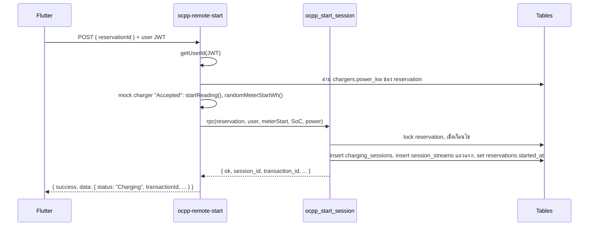
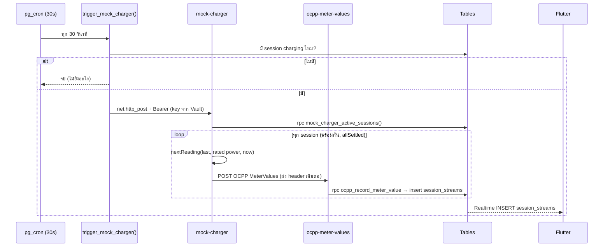
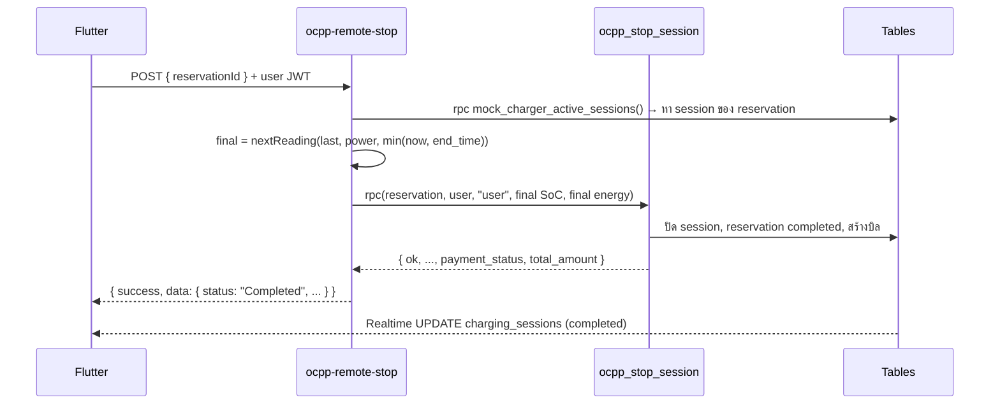
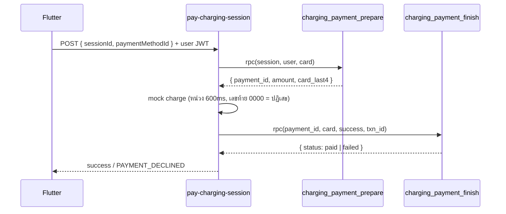

# Charging Session – Flow & การทำงานของแต่ละส่วน

เอกสารนี้อธิบายว่าระบบชาร์จทำงานยังไงตั้งแต่กด Start จนจ่ายเงินเสร็จ ใครเรียกอะไร และแต่ละ function ทำอะไร
(วิธี setup ดูที่ [CHARGING_SETUP.md](CHARGING_SETUP.md))

---

## 1. ภาพรวม

ระบบนี้จำลอง OCPP (มาตรฐานที่ charger จริงคุยกับ backend):

- **CSMS (backend)** = edge functions + SQL functions ของเรา
- **Charger** = `mock-charger` (ตัวจำลอง) – วันที่ต่อ charger จริงลบตัวนี้ทิ้ง ส่วนอื่นใช้ต่อได้

```
                         ┌─────────────────── Supabase ───────────────────┐
 Flutter                 │  Edge functions            SQL functions        │
 ───────                 │  ──────────────            ─────────────        │
 Start Charging ───────▶ │  ocpp-remote-start ──────▶ ocpp_start_session   │──┐
 Stop Charging  ───────▶ │  ocpp-remote-stop  ──────▶ ocpp_stop_session    │  │
 Pay            ───────▶ │  pay-charging-session ───▶ charging_payment_*   │  │ เขียน
                         │                                                 │  ▼
                         │  pg_cron (30s)                                  │ ตาราง
                         │   └▶ trigger_mock_charger()                     │  ▲
                         │        └▶ mock-charger ──▶ mock_charger_active_  │  │
                         │             │              sessions             │  │
                         │             ├─ auto-stop ─▶ ocpp_stop_session    │──┤
                         │             └▶ ocpp-meter-values ─▶              │  │
                         │                  ocpp_record_meter_value        │──┘
 หน้าจอ live  ◀──Realtime── charging_sessions / session_streams            │
                         └─────────────────────────────────────────────────┘
```

### ตาราง

| ตาราง | 1 แถว = | เขียนโดย |
|---|---|---|
| `reservations` (เดิม) | 1 booking | start: set `started_at` / stop: `status = completed` |
| `charging_sessions` | 1 การชาร์จ (OCPP transaction) | `ocpp_start_session` สร้าง, `ocpp_stop_session` ปิด |
| `session_streams` | 1 ค่าที่ charger รายงาน (SoC, kW, kWh สะสม) | `ocpp_start_session` (แถวแรก), `ocpp_record_meter_value` (ระหว่างชาร์จ), `ocpp_stop_session` (แถวสุดท้าย) |
| `session_payments` | 1 บิลต่อ session | `ocpp_stop_session` สร้าง, `charging_payment_finish` อัพเดท |
| `booking_fee` (เดิม) | ค่าจองที่จ่ายแล้ว | อ่านอย่างเดียว ตอนคิดบิล |

แอป **อ่าน** ได้เฉพาะของตัวเอง (RLS) และ **เขียนไม่ได้เลย** – ทุกการเขียนผ่าน SQL functions ที่เรียกได้เฉพาะ service role (edge functions)

### สถานะเปลี่ยนยังไง

| เหตุการณ์ | `reservations` | `charging_sessions` | `session_payments` |
|---|---|---|---|
| จองเสร็จ | `confirmed`, `started_at = null` | – | – |
| Start Charging | `confirmed`, `started_at = now` | `charging` | – |
| Stop (user / หมดเวลา / แบตเต็ม) | `completed` | `completed` + `stop_reason` | `unpaid` (หรือ `paid` ถ้ายอด 0) |
| จ่ายไม่ผ่าน | | | `failed` (จ่ายใหม่ได้) |
| จ่ายสำเร็จ | | | `paid` |

---

## 1.5 Check charger status (ปุ่ม I've Plugged In)

- **ใครเรียก:** แอป ตอนกด I've Plugged In ในหน้า Plug In Your Car
- **Edge function `ocpp-status`:** request `{ chargerId, connectorId: 1 }` + user JWT
  - อ่าน `chargers.mock_error_code` (switch ทดสอบ)
  - `null` → `{ status: "Available", errorCode: "NoError" }` → เปิดหน้า Charging Session
  - มีค่า → `{ status: "Unavailable", errorCode: <ค่านั้น> }` → แอปเรียก `refund-booking-fee` ต่อทันที
- `ocpp-status` อ่านอย่างเดียว ไม่เขียนข้อมูล

### Refund (charger unavailable)

- **Edge function `refund-booking-fee`:** request `{ reservationId }` + user JWT → สร้าง `mock_refund_...` → เรียก SQL `refund_booking_fee`
- **SQL `refund_booking_fee(p_reservation_id, p_user_id, p_refund_transaction_id)`** (lock reservation `for update`):

  | เช็ค | error_code |
  |---|---|
  | ไม่มี reservation | `RESERVATION_NOT_FOUND` |
  | ไม่ใช่เจ้าของ | `NOT_OWNER` |
  | ไม่ใช่ `confirmed` หรือเริ่มชาร์จแล้ว | `RESERVATION_NOT_ACTIVE` |
  | `chargers.mock_error_code` เป็น null (charger ปกติ) | `CHARGER_AVAILABLE` |
  | คืนเงินไปแล้ว | `ALREADY_REFUNDED` |

  ผ่าน → `booking_fee`: `refunded` + `refunded_at` + `refund_transaction_id`, `reservations`: `cancelled`
- แอปเปิดหน้า **Charger Unavailable** (เหตุผล + ยอดที่คืน + ปุ่ม Done กลับ Bookings) การ์ดใน Bookings มีป้าย **Refunded**
- Host revenue: ค่าจองที่ `refunded` ไม่ถูกนับ (นับเฉพาะ `paid`)

---

## 2. Start Charging

### ลำดับ



### Edge function: `ocpp-remote-start`

- **ใครเรียก:** แอป ตอนกด Start Charging (`ChargingSessionService.startCharging`)
- **Auth:** JWT ของ user (gateway verify) → `getUserId()` ถาม Supabase Auth ว่าเป็นใคร
- **ทำอะไร:**
  1. อ่าน `reservationId` จาก body (ไม่มี → `INVALID_REQUEST`)
  2. อ่าน `power_kw` ของ charger ที่จองไว้ (ใช้สร้างค่าแรก)
  3. **จำลอง charger ตอบรับ** – `charger_sim.ts`:
     - `startReading()` → SoC สุ่ม 10–40%, power = rated ±2%, energy 0
     - `randomMeterStartWh()` → ค่ามิเตอร์สะสมของ charger ตอนเริ่ม (Wh) สุ่ม 100,000–2,000,000
  4. เรียก SQL `ocpp_start_session`
  5. แปลงผลเป็น response OCPP-style: `status, sessionId, chargerId, connectorId (=1), transactionId, meterStart, startedAt`

### SQL function: `ocpp_start_session(p_reservation_id, p_user_id, p_meter_start_wh, p_start_soc, p_power_kw)`

1. `select ... for update` – **lock แถว reservation** กันกด Start ซ้อนกัน 2 ครั้ง
2. เช็คตามลำดับ (เจอข้อแรกที่ไม่ผ่านก็คืน error ทันที):

   | เงื่อนไข | error_code |
   |---|---|
   | ไม่มี reservation | `RESERVATION_NOT_FOUND` |
   | ไม่ใช่ของ user นี้ | `NOT_OWNER` |
   | มี session ของ reservation นี้แล้ว | `SESSION_ALREADY_STARTED` |
   | status = cancelled | `RESERVATION_CANCELLED` |
   | status อื่นที่ไม่ใช่ confirmed | `RESERVATION_NOT_ACTIVE` |
   | ตอนนี้ < start_time − 30 นาที | `TOO_EARLY` |
   | ตอนนี้ > start_time + 15 นาที | `RESERVATION_EXPIRED` |
   | เริ่มก่อนเวลา และ charger มี session `charging` อื่นอยู่ | `CHARGER_IN_USE` |

3. อ่าน `chargers.price_per_kwh` → เก็บเป็น `price_per_kwh_at_start` (ล็อกราคา)
4. `insert charging_sessions` (status `charging`, `transaction_id` เลขรันอัตโนมัติ)
5. `insert session_streams` แถวแรก (SoC เริ่มต้น, energy 0) → แอปมีค่าโชว์ทันที
6. `update reservations set started_at = now()` → ระบบเดิม (เช็ค charger ว่าง, cron ยกเลิก no-show) ใช้ต่อได้
7. คืน `{ ok: true, session_id, transaction_id, charger_id, meter_start, started_at }`

ทุกขั้นอยู่ใน transaction เดียว – ถ้าขั้นไหนพัง ยกเลิกหมด

---

## 3. Meter stream (ค่าระหว่างชาร์จ)

### ลำดับ



### SQL function: `trigger_mock_charger()`

- **ใครเรียก:** pg_cron job `mock-charger-tick` ทุก 30 วินาที
- **ทำอะไร:**
  1. ไม่มี `charging_sessions.status = 'charging'` → `return` (ไม่เรียก edge function เลย)
  2. อ่าน `project_url`, `service_role_key` จาก **Vault**
  3. `net.http_post` ไป `<project_url>/functions/v1/mock-charger` พร้อม `Authorization: Bearer <service_role_key>`, body `{}`
     - แบบ async: คิว request แล้วจบเลย ไม่รอผล (ผลไปอยู่ที่ `net._http_response`)
- `security definer` เพราะต้องอ่าน Vault; revoke จาก anon/authenticated

### Edge function: `mock-charger` (ตัวจำลอง charger)

- **ใครเรียก:** `trigger_mock_charger()` (หรือ curl ตอนทดสอบ)
- **Auth:** gateway verify JWT + โค้ดเช็ค `role = service_role` (ไม่ผ่าน → 403 `Scheduler only.`)
- **ทำอะไร:**
  1. เรียก SQL `mock_charger_active_sessions()` เอาทุก session ที่ชาร์จอยู่
  2. ทำ `tick()` ของทุก session **พร้อมกัน** ด้วย `Promise.allSettled` – session ไหนพังไม่กระทบตัวอื่น
  3. ตอบ `{ sessions: n, results: [...] }` (ผลของแต่ละ session: `meter_values` / `stopped` / `skipped` / `error`)

**`tick()` ของ 1 session:**

1. ไม่มีค่าล่าสุด → `skipped (no_reading)`
2. ค่าล่าสุดอายุ < 20 วินาที และไม่ได้ส่ง `force: true` → `skipped (too_soon)` (กัน tick ซ้อน)
3. ตอนนี้ ≥ `end_time` → คำนวณค่าถึง `end_time` แล้ว **stop (`time_up`)** – ดูหัวข้อ 5
4. คำนวณค่าใหม่ `nextReading(last, rated_power_kw, now)`
5. SoC ≥ 100 → **stop (`battery_full`)**
6. ไม่งั้น → สร้าง payload OCPP MeterValues แล้ว POST ไป `ocpp-meter-values` โดย **ส่ง `Authorization` เดิมที่ cron ส่งมาต่อ**

**สูตรจำลอง (`_shared/charger_sim.ts`):**

```
Δt (ชม.)     = (now − เวลาของค่าล่าสุด) / 3600
power (kW)  = rated × taper × (1 ± 2%)
              taper = 1 ถ้า SoC ≤ 80, ไม่งั้นลดเชิงเส้นจนเหลือ 0.2 ที่ SoC 100
energy      = energy ล่าสุด + power × Δt
SoC         = SoC ล่าสุด + (power × Δt) / 60 kWh × 100   (สูงสุด 100)
```

ทุก session ใช้ค่าล่าสุด / กำลังไฟ charger / end_time **ของตัวเอง** ค่าไม่ปนกัน

**Payload ที่ส่ง (OCPP 1.6 MeterValues):**

```json
{
  "chargerId": "<uuid>", "connectorId": 1, "transactionId": 12345,
  "meterValue": [{
    "timestamp": "2026-10-18T20:16:00.000Z",
    "sampledValue": [
      { "value": "1000368", "measurand": "Energy.Active.Import.Register", "unit": "Wh", ... },
      { "value": "21.763",  "measurand": "Power.Active.Import",          "unit": "kW", ... },
      { "value": "18.61",   "measurand": "SoC",                          "unit": "Percent", ... }
    ]
  }]
}
```

`Energy.Active.Import.Register` = มิเตอร์สะสมของ charger (= `meter_start_wh` + พลังงานของ session × 1000) ตามมาตรฐาน OCPP

### SQL function: `mock_charger_active_sessions()`

- **ใครเรียก:** `mock-charger`, `ocpp-remote-stop`
- **คืน:** 1 แถวต่อ session ที่ `charging` – `session_id, reservation_id, transaction_id, charger_id, meter_start_wh, rated_power_kw (chargers.power_kw, null = 7), end_time, ค่าล่าสุด (SoC, power, energy, เวลา)`
- ค่าล่าสุดดึงด้วย `left join lateral (... order by created_at desc limit 1)` – query เดียวได้ครบทุก session

### Edge function: `ocpp-meter-values` (ตัวรับ)

- **ใครเรียก:** `mock-charger` (ในอนาคต = charger จริง / OCPP gateway)
- **Auth:** gateway verify JWT + `role = service_role` (ไม่ผ่าน → 403 `Chargers only.`) – แอปปลอมค่าไม่ได้
- **ทำอะไร:**
  1. เช็ค `transactionId` และ `meterValue` มีจริง
  2. `parseSample()` ดึง 3 measurand + แปลงหน่วย (kWh→Wh, W→kW)
  3. เรียก SQL `ocpp_record_meter_value` ทีละ sample
  4. ตอบ `{ chargerId, transactionId, status: "Charging", stored }`

### SQL function: `ocpp_record_meter_value(p_transaction_id, p_soc, p_power_kw, p_register_wh, p_timestamp)`

1. หา session จาก `transaction_id` แบบ `for share` (กันไม่ให้ stop ปิด session ระหว่าง insert)
2. ไม่เจอ หรือไม่ได้ `charging` แล้ว → `NO_ACTIVE_TRANSACTION` (กรณี tick ชนกับ stop)
3. `insert session_streams`:
   - `total_energy_received_kwh = (register_wh − meter_start_wh) / 1000`
   - SoC ถูกจำกัด 0–100, power ไม่ติดลบ
4. → Realtime ส่ง INSERT ไปที่แอป

---

## 4. Stop Charging (user กด)



### Edge function: `ocpp-remote-stop`

- **ใครเรียก:** แอป ตอนกด Stop Charging (`ChargingSessionService.stopCharging`)
- **Auth:** JWT ของ user → `getUserId()`
- **ทำอะไร:**
  1. อ่าน `reservationId`
  2. หา session ที่ชาร์จอยู่จาก `mock_charger_active_sessions()`
  3. **จำลอง charger ส่งค่าสุดท้าย** – `nextReading()` ถึงเวลา `min(now, end_time)` (กดหยุดเลยเวลาจองก็ไม่คิดเกิน)
  4. เรียก `ocpp_stop_session` (ผ่าน `_shared/ocpp.ts → stopSession`) ด้วย `stop_reason = "user"`
  5. ตอบ `status: "Completed", sessionId, chargerId, connectorId, transactionId, meterStop, stoppedAt, stopReason, totalEnergyKwh, paymentStatus, totalAmount`

### SQL function: `ocpp_stop_session(p_reservation_id, p_user_id, p_stop_reason, p_final_soc, p_final_power_kw, p_final_energy_kwh)`

1. หา reservation (ไม่เจอ → `RESERVATION_NOT_FOUND`)
2. `p_user_id` ไม่ null และไม่ใช่เจ้าของ → `NOT_OWNER`
   (`p_user_id = null` = ระบบสั่งหยุดเอง ข้ามการเช็คเจ้าของ)
3. lock session `for update` – ไม่ได้ `charging` → `NO_ACTIVE_TRANSACTION` (กันหยุดซ้ำ)
4. `insert session_streams` แถวสุดท้าย (power 0, energy สุดท้าย)
5. `update charging_sessions` → `completed`, `ended_at`, `stop_reason`, `total_energy_kwh`, `meter_stop_wh = meter_start_wh + energy × 1000`
6. `update reservations` → `completed`
7. **คิดบิล** แล้ว `insert session_payments`:

   ```
   energy_amount   = round(total_energy_kwh × price_per_kwh_at_start, 2)
   booking_fee     = booking_fee.amount ของ reservation (ไม่มี = 0)
   total_amount    = max(energy_amount − booking_fee, 0)     ← ยอดที่ตัดบัตร
   platform_amount = round(total_amount × 15%, 2)
   host_amount     = total_amount − platform_amount
   status          = total_amount = 0 ? 'paid' : 'unpaid'
   ```
   ตัวอย่าง: ค่าไฟ 100, จอง 10 → total 90, platform 13.50, host 76.50
   ค่าไฟน้อยกว่าค่าจอง → ทุกยอด 0, `paid` ทันที, ไม่คืนค่าจอง

8. คืน `{ ok, session_id, transaction_id, charger_id, meter_stop, stopped_at, stop_reason, total_energy_kwh, payment_id, payment_status, total_amount }`

---

## 5. Auto-stop (หมดเวลาจอง / แบตเต็ม)

ไม่มี function แยก – อยู่ใน `tick()` ของ `mock-charger` (หัวข้อ 3)

| เงื่อนไข | ค่าสุดท้ายคิดถึง | stop_reason |
|---|---|---|
| ตอน tick ≥ `end_time` | `end_time` | `time_up` |
| SoC ที่คำนวณได้ ≥ 100 | ตอนนี้ | `battery_full` |

เรียก `ocpp_stop_session` ตรง (ผ่าน `stopSession()`, `p_user_id = null`) ไม่ได้ยิง HTTP ไป `ocpp-remote-stop`
ผลเหมือน user กด Stop ทุกอย่าง (session completed, reservation completed, สร้างบิล)

ช้ากว่าเวลาจริงได้ไม่เกิน ~30 วินาที (รอ tick) – แต่บิลคิดถึง `end_time` พอดี

แอปรู้ได้ยังไง: หน้า Charging subscribe แถว `charging_sessions` ผ่าน Realtime → เห็น `completed` → ไปหน้า Summary เอง

---

## 6. จ่ายเงิน



### Edge function: `pay-charging-session`

- **ใครเรียก:** แอป ตอนกด Pay ในหน้า Session Summary (`ChargingSessionService.payForSession`)
- **Auth:** JWT ของ user → `getUserId()`
- **ทำอะไร:**
  1. อ่าน `sessionId`, `paymentMethodId`
  2. `charging_payment_prepare` → ได้ยอดเงิน + เลขท้ายบัตร (**ยอดมาจากบิลใน DB ไม่ใช่จากแอป**)
  3. **mock ตัดบัตร** – หน่วง 600ms, เลขท้าย `0000` = ปฏิเสธ, อื่นๆ = สำเร็จ + สร้าง `mock_txn_...`
  4. `charging_payment_finish` บันทึกผล
  5. สำเร็จ → `{ status: "paid", paymentId, totalAmount, transactionId, paidAt }`
     ปฏิเสธ → 402 `PAYMENT_DECLINED` (บิลเป็น `failed` แอปให้ลองใหม่ / เปลี่ยนบัตร)

### SQL function: `charging_payment_prepare(p_session_id, p_user_id, p_payment_method_id)`

| เช็ค | error_code |
|---|---|
| ไม่มี session | `SESSION_NOT_FOUND` |
| ไม่ใช่เจ้าของ (ผ่าน reservations.user_id) | `NOT_OWNER` |
| ยังไม่มีบิล | `SESSION_NOT_FOUND` |
| บิล `paid` แล้ว | `ALREADY_PAID` |
| บัตรไม่ใช่ของ user | `INVALID_PAYMENT_METHOD` |

ผ่าน → คืน `{ payment_id, amount (= total_amount), card_last4 }` ไม่ได้เขียนอะไร

### SQL function: `charging_payment_finish(p_payment_id, p_payment_method_id, p_success, p_transaction_id)`

- `update session_payments ... where status <> 'paid'`
  - สำเร็จ → `paid`, `transaction_id`, `paid_at`, `payment_method_id`
  - ไม่สำเร็จ → `failed`, `payment_method_id`
- ไม่มีแถวถูกอัพเดท (จ่ายไปแล้ว) → `ALREADY_PAID` – ไม่มีทางเปลี่ยน `paid` กลับเป็นอย่างอื่น

---

## 7. ฝั่งแอป (สรุปสั้น)

| ส่วน | ทำอะไร |
|---|---|
| Bookings → Start | เช็คเบื้องต้น (status, เวลา, charger ว่าง) → Plug In → Charging Session; ถ้ากำลังชาร์จอยู่แล้วเข้าหน้า session ตรง |
| Charging Session | Start/Stop เรียก edge functions; subscribe `session_streams` (ค่าล่าสุด) + `charging_sessions` (รู้ตอน completed); Duration นับเองจาก `started_at`; Cost = `price_per_kwh_at_start × total_energy_received_kwh` |
| Session Summary | อ่าน session + บิล + บัตร → Pay |
| Payment Complete | Back to Home |
| `PendingSessionGate` | ตอนเปิดแอป / กลับเข้าแอป: มี session `charging` → หน้า Charging, มีบิลไม่ `paid` → หน้า Summary (ออกไม่ได้จนจ่าย) |

การเช็คในแอปเป็นแค่ UX – กฎจริงบังคับที่ SQL (`ocpp_start_session` ฯลฯ)

---

## 8. Auth แต่ละจุด

| ผู้เรียก → ผู้ถูกเรียก | ใช้ credential | เช็คโดย |
|---|---|---|
| แอป → start / stop / pay | JWT ของ user ที่ login | gateway (signature) + `getUserId()` + SQL เช็คเจ้าของ |
| pg_cron → `mock-charger` | Vault `service_role_key` (legacy JWT) | gateway (signature) + `role = service_role` |
| `mock-charger` → `ocpp-meter-values` | header เดิมจาก cron | gateway + `role = service_role` |
| edge functions → SQL functions | env `SUPABASE_SERVICE_ROLE_KEY` (Supabase ใส่ให้) | SQL functions grant ให้ `service_role` เท่านั้น |
| แอป → ตาราง (อ่าน) | JWT ของ user | RLS (เฉพาะ reservation ของตัวเอง) |

---

## 9. การกันปัญหาทำงานซ้อนกัน

| สถานการณ์ | กันด้วย |
|---|---|
| กด Start 2 ครั้งพร้อมกัน | lock reservation `for update` + unique `charging_sessions.reservation_id` → ครั้งที่ 2 ได้ `SESSION_ALREADY_STARTED` |
| tick ส่งค่าเข้ามาตอนกำลัง stop | `for share` ใน record vs `for update` ใน stop → ทำทีละอัน; หลัง stop ค่าที่เข้ามาโดน `NO_ACTIVE_TRANSACTION` |
| user กด Stop พร้อม auto-stop | lock session `for update` → อันที่สองได้ `NO_ACTIVE_TRANSACTION` (แอปโหลดใหม่แล้วไปหน้า Summary) |
| cron tick ซ้อน / สั่ง tick มือ | ข้าม session ที่ค่าล่าสุดอายุ < 20 วินาที |
| session หนึ่ง error ตอน tick | `Promise.allSettled` – session อื่นทำงานต่อ |
| จ่ายซ้ำ | `charging_payment_finish` อัพเดทเฉพาะ `status <> 'paid'` + unique `session_payments.session_id` |

---

## 10. Cron jobs

| job | schedule | ทำอะไร |
|---|---|---|
| `mock-charger-tick` | `30 seconds` | `trigger_mock_charger()` |
| `cleanup-cron-run-details` | `59 16 * * *` (23:59 เวลาไทย) | ลบ `cron.job_run_details` เก่ากว่า 1 วัน |
| (เดิม) cron ยกเลิก no-show | – | ไม่อยู่ใน repo – ต้องข้าม reservation ที่มี `started_at` |
